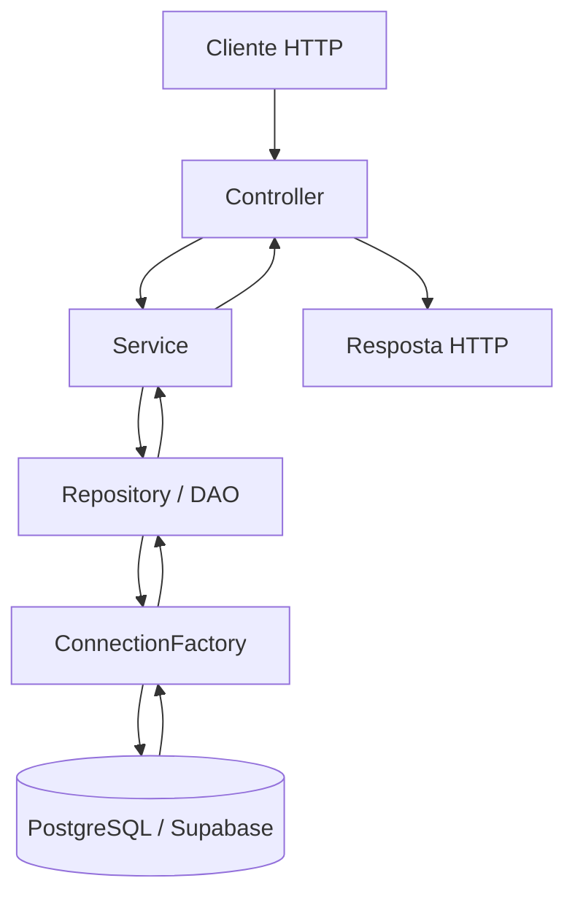
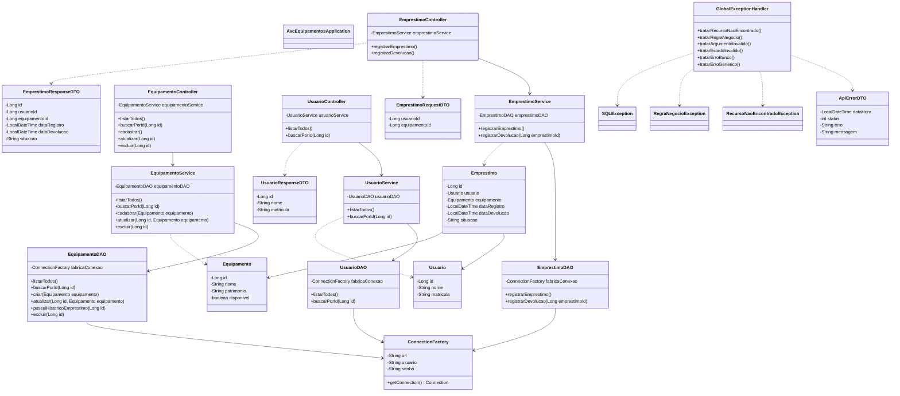

# Sistema de Empréstimo de Equipamentos

Projeto acadêmico desenvolvido para a disciplina de Técnicas de Programação da UNISA. O sistema tem como objetivo gerenciar empréstimos e devoluções de equipamentos, relacionando usuários, equipamentos e registros de empréstimo.

## 1. Tecnologias utilizadas

- **Java** — linguagem de programação.
- **Spring Boot** — estrutura da aplicação e exposição dos endpoints REST.
- **JDBC** — comunicação com o banco de dados por meio de comandos SQL.
- **PostgreSQL** — banco de dados relacional.
- **Supabase** — serviço utilizado para disponibilização do PostgreSQL.
- **Maven** — gerenciamento de dependências e execução dos testes.

## 2. Arquitetura do sistema

A aplicação utiliza uma arquitetura em camadas, separando as responsabilidades do código.

| Camada | Responsabilidade |
|---|---|
| `controller` | Receber requisições HTTP e retornar respostas da API. |
| `service` | Aplicar validações e regras de negócio. |
| `repository` / `DAO` | Executar consultas e operações SQL no banco de dados. |
| `model` | Representar as entidades do domínio. |
| `dto` | Transportar os dados de entrada e saída da API. |
| `config` | Centralizar configurações de infraestrutura, incluindo a conexão com o banco. |
| `exception` | Definir exceções específicas e centralizar o tratamento de erros da API. |

### Fluxo de uma requisição

Uma requisição HTTP chega ao controller, que utiliza o service para executar a operação. O service acessa a camada de persistência, responsável pelas operações no banco de dados. O resultado retorna pelas camadas até formar a resposta HTTP.



## 3. Diagrama de classes UML

O diagrama abaixo contempla as classes identificadas no código, seus principais atributos, métodos e dependências:



## 4. Persistência e transações

A classe `ConnectionFactory` centraliza a criação de conexões JDBC. A classe `EmprestimoDAO` executa as operações de empréstimo e devolução utilizando comandos SQL.

As operações de empréstimo e devolução utilizam transações manuais, com `commit` para confirmar as alterações e `rollback` em caso de falha. O empréstimo também utiliza bloqueio de registro durante a verificação da disponibilidade do equipamento, reduzindo o risco de empréstimos simultâneos do mesmo item.

## 5. Endpoints de empréstimos

| Método | Endpoint | Finalidade |
|---|---|---|
| `POST` | `/emprestimos` | Registrar um empréstimo. |
| `PATCH` | `/emprestimos/{id}/devolucao` | Registrar a devolução de um empréstimo. |

### Exemplo de requisição para empréstimo

```json
{
  "usuarioId": 1,
  "equipamentoId": 1
}
```

O endpoint de criação retorna o status HTTP `201 Created` quando a operação é concluída. O endpoint de devolução retorna `204 No Content` em caso de sucesso.

## 6. Configuração do banco de dados

A aplicação utiliza variáveis de ambiente para configurar a conexão com o PostgreSQL:

- `DB_URL` — URL JDBC do banco.
- `DB_USER` — usuário do banco.
- `DB_PASSWORD` — senha do banco.

Essas variáveis devem ser configuradas no ambiente de execução. Credenciais reais não devem ser adicionadas ao repositório.

## 7. Testes

Os testes automatizados estão localizados em `src/test/java`. Para executar a suíte completa, utilize o Maven na pasta que contém o arquivo `pom.xml`:

```bash
mvn clean test
```
### Resultado da execução

Na validação integrada do projeto, foram executados 39 testes automatizados, distribuídos entre as classes de teste de conexão, aplicação, usuários, empréstimos, algoritmos e tratamento global de exceções.

Resultado: 39 testes aprovados, sem falhas, erros ou testes ignorados (BUILD SUCCESS).

A compilação bem-sucedida, isoladamente, não comprova o funcionamento dos fluxos da API. Por isso, a validação considera também a execução dos testes automatizados.

## 8. Organização do projeto

```text
src/
├── main/
│   ├── java/br/com/unisa/avc_equipamentos/
│   │   ├── algoritmos/
│   │   ├── config/
│   │   ├── controller/
│   │   ├── dto/
│   │   ├── exception/
│   │   ├── model/
│   │   ├── repository/
│   │   ├── service/
│   │   └── AvcEquipamentosApplication.java
│   └── resources/
│       └── application.properties
└── test/
    └── java/br/com/unisa/avc_equipamentos/
```

## 9. Endpoints de equipamentos

| Método | Endpoint | Finalidade |
|---|---|---|
| GET | `/equipamentos` | Listar equipamentos |
| GET | `/equipamentos/{id}` | Buscar equipamento por ID |
| POST | `/equipamentos` | Cadastrar equipamento |
| PUT | `/equipamentos/{id}` | Atualizar equipamento |
| DELETE | `/equipamentos/{id}` | Excluir equipamento |

### Exemplo de cadastro

Requisição `POST /equipamentos`:

```json
{
  "nome": "Notebook Dell",
  "patrimonio": "PAT-001",
  "disponivel": true
}
```

Equipamentos novos são cadastrados como disponíveis. O nome e o patrimônio são obrigatórios.

### Regra de exclusão

Não é permitido excluir um equipamento que possua histórico de empréstimos. Nesse caso, a API retorna `409 Conflict`. Quando o equipamento não é encontrado, a API retorna `404 Not Found`.

## 10. Módulo de Usuários e Tratamento Global de Erros

O módulo de usuários foi desenvolvido nas tarefas T-11 a T-14, sob responsabilidade de Beatriz Pereira.

### Implementação

- **Modelos e DTOs (T-11):** implementação do `UsuarioResponseDTO`, responsável por transportar os dados necessários dos usuários (`id`, `nome` e `matricula`), sem expor diretamente a entidade de domínio.
- **Acesso a dados (T-12):** implementação do `UsuarioDAO`, utilizando JDBC e `PreparedStatement` para realizar consultas ao banco de dados, com gerenciamento adequado dos recursos.
- **Serviço e endpoints REST (T-13):** implementação do `UsuarioController`, disponibilizando:
  - `GET /usuarios`: lista os usuários cadastrados.
  - `GET /usuarios/{id}`: consulta um usuário pelo identificador, retornando HTTP 404 quando não encontrado.
- **Tratamento global de exceções (T-14):** implementação do `GlobalExceptionHandler`, utilizando `@RestControllerAdvice` para centralizar o tratamento de erros e padronizar as respostas por meio do `ApiErrorDTO`.

### Mapeamento de erros HTTP

| Status | Situação |
|---|---|
| `400 Bad Request` | Regras de negócio e argumentos inválidos. |
| `404 Not Found` | Recurso não encontrado. |
| `409 Conflict` | Estado atual do recurso impede a operação. |
| `500 Internal Server Error` | Falhas de persistência e erros inesperados. |

As respostas de erro incluem data e hora, código HTTP, identificação do erro e mensagem descritiva.

## 11. Módulo de Algoritmos

O módulo de algoritmos está localizado em `src/main/java/br/com/unisa/avc_equipamentos/algoritmos/ModuloAlgoritmos.java`.

A implementação original foi desenvolvida por Fernando Oliveira. Durante a revisão técnica, foram realizados ajustes para adequar os critérios de busca e ordenação ao requisito de identificação dos equipamentos por ID.

O módulo trabalha com uma coleção de equipamentos armazenada em memória, recebida por meio do construtor da classe. A coleção é copiada para uma lista interna, sem realizar consultas SQL diretamente ou expor endpoints REST.

### Busca linear — T-17

O método `buscaLinear(Long id)` percorre sequencialmente a coleção até encontrar um equipamento com o ID informado.

- Complexidade de tempo: O(n) no pior caso.
- Melhor caso: O(1), quando o equipamento está na primeira posição.
- Complexidade de espaço adicional: O(1).

### Busca binária — T-18

O método `buscaBinaria(Long id)` utiliza a busca binária para localizar um equipamento pelo ID. Antes da pesquisa, a coleção é ordenada em ordem crescente de ID utilizando o Insertion Sort.

- Complexidade da busca: O(log n).
- Complexidade da ordenação prévia: O(n²) no pior caso.
- Complexidade total da chamada: O(n²) no pior caso, considerando a ordenação prévia.
- Complexidade de espaço adicional: O(1).

A ordenação prévia é necessária porque a busca binária depende de uma coleção ordenada pelo mesmo critério utilizado na comparação.

### Insertion Sort — T-19

O método `insertionSort()` ordena os equipamentos em ordem crescente de ID, inserindo cada elemento na posição correta em relação aos elementos anteriores.

- Melhor caso: O(n), quando a coleção já está ordenada.
- Pior caso: O(n²), quando são necessários muitos deslocamentos.
- Complexidade de espaço adicional: O(1).

### Observações

Os algoritmos utilizam o atributo `id` da classe `Equipamento`, do tipo `Long`, como critério de comparação.

O construtor recebe uma lista não nula e valida se todos os equipamentos possuem identificadores válidos. A busca retorna `null` quando o ID informado não é encontrado ou é nulo.

A ordenação modifica a lista interna do módulo, enquanto o método `getEquipamentos()` retorna uma cópia da coleção.

A compilação e a demonstração do módulo foram executadas com sucesso. Os testes JUnit específicos dos algoritmos também foram implementados e executados com sucesso, totalizando 15 testes para o módulo. Na execução integrada da suíte de testes do projeto, foram obtidos 39 testes aprovados, sem falhas ou erros.

### Demonstração reproduzível

A classe `DemonstracaoAlgoritmos` cria uma coleção fixa de cinco equipamentos em memória, com IDs inicialmente fora de ordem.

Os dados são gerados localmente no código, sem consulta ao PostgreSQL/Supabase e sem requisições HTTP ou utilização do Postman.

Para executar a demonstração, na pasta `avc-equipamentos`, execute:

```bash
mvn -DskipTests compile
java -cp target/classes br.com.unisa.avc_equipamentos.algoritmos.DemonstracaoAlgoritmos
```

**Saída esperada:**

```text
Busca linear pelo ID 3:
Notebook

Busca binária pelo ID 4:
Projetor

Equipamentos ordenados por ID:
1 - Monitor
2 - Mouse
3 - Notebook
4 - Projetor
5 - Teclado
```
