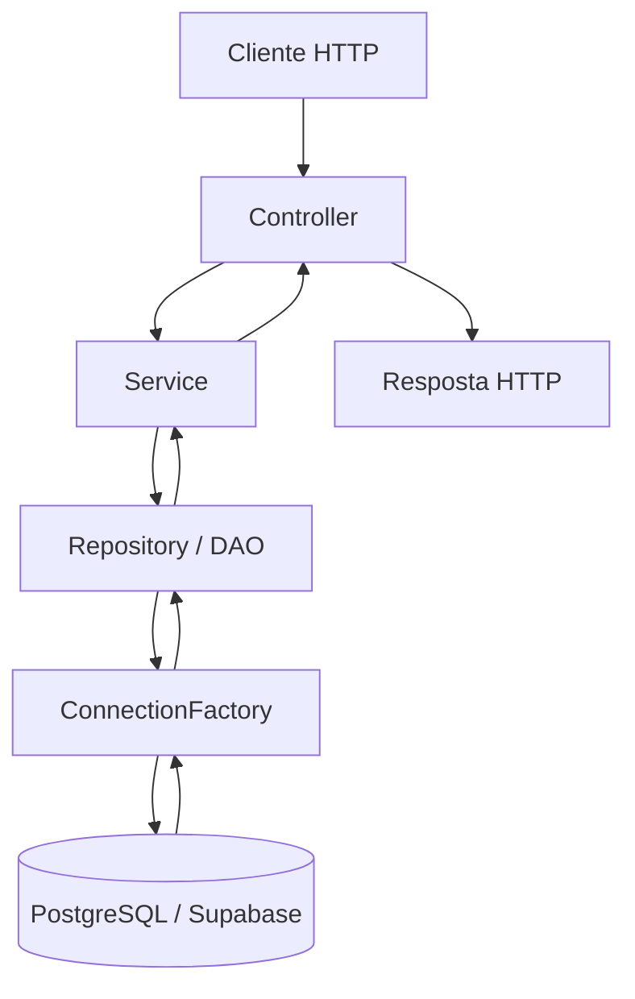
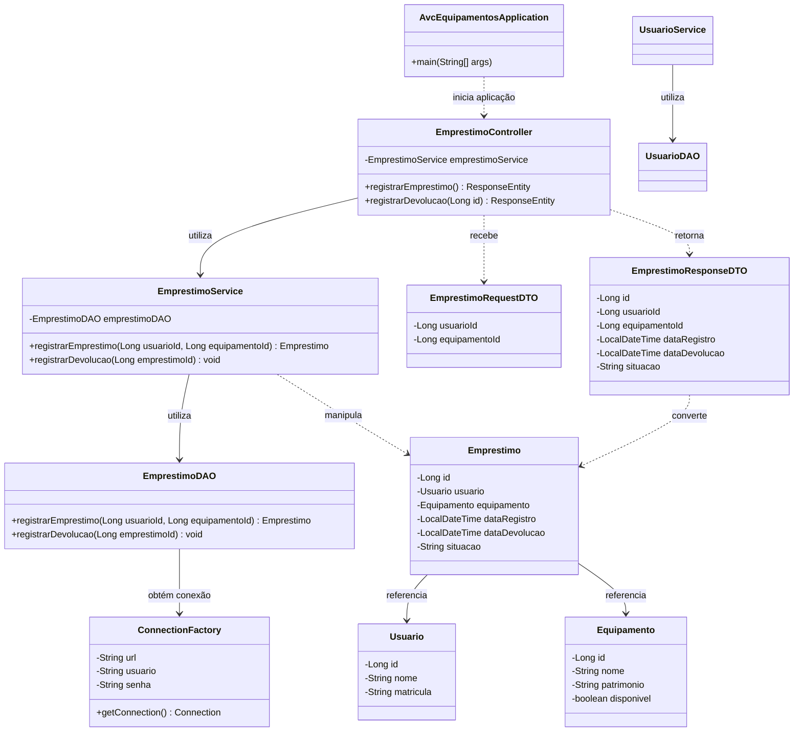

# Sistema de Empréstimo de Equipamentos

Projeto acadêmico desenvolvido para a disciplina de Engenharia de Software da UNISA. O sistema tem como objetivo gerenciar empréstimos e devoluções de equipamentos, relacionando usuários, equipamentos e registros de empréstimo.

## 1. Tecnologias utilizadas

- **Java** — linguagem de programação.
- **Spring Boot** — estrutura da aplicação e exposição dos endpoints REST.
- **JDBC** — comunicação com o banco de dados por meio de comandos SQL.
- **PostgreSQL** — banco de dados relacional.
- **Supabase** — serviço utilizado para disponibilização do PostgreSQL.
- **Maven** — gerenciamento de dependências e execução dos testes.

## 2. Arquitetura do sistema

A aplicação utiliza uma arquitetura em camadas, separando as responsabilidades do código.

| Camada | Responsabilidade |
|---|---|
| `controller` | Receber requisições HTTP e retornar respostas da API. |
| `service` | Aplicar validações e regras de negócio. |
| `repository` | Executar consultas e operações SQL no banco de dados. |
| `model` | Representar as entidades do domínio. |
| `dto` | Transportar os dados de entrada e saída da API. |
| `config` | Centralizar configurações de infraestrutura, incluindo a conexão com o banco. |

### Fluxo de uma requisição

Uma requisição HTTP chega ao controller, que utiliza o service para executar a operação. O service acessa o repository, responsável pela persistência no banco de dados. O resultado retorna pelas camadas até formar a resposta HTTP.



## 3. Diagrama de classes UML

O diagrama abaixo representa as principais classes identificadas no código da aplicação.



## 4. Persistência e transações

A classe `ConnectionFactory` centraliza a criação de conexões JDBC. A classe `EmprestimoDAO` executa as operações de empréstimo e devolução utilizando comandos SQL.

As operações de empréstimo e devolução utilizam transações manuais, com `commit` para confirmar as alterações e `rollback` em caso de falha. O empréstimo também utiliza bloqueio de registro durante a verificação da disponibilidade do equipamento, reduzindo o risco de empréstimos simultâneos do mesmo item.

## 5. Endpoints de empréstimos

| Método | Endpoint | Finalidade |
|---|---|---|
| `POST` | `/emprestimos` | Registrar um empréstimo. |
| `PATCH` | `/emprestimos/{id}/devolucao` | Registrar a devolução de um empréstimo. |

### Exemplo de requisição para empréstimo

```json
{
  "usuarioId": 1,
  "equipamentoId": 1
}
```

O endpoint de criação retorna o status HTTP `201 Created` quando a operação é concluída. O endpoint de devolução retorna `204 No Content` em caso de sucesso.

## 6. Configuração do banco de dados

A aplicação utiliza variáveis de ambiente para configurar a conexão com o PostgreSQL:

- `DB_URL` — URL JDBC do banco.
- `DB_USER` — usuário do banco.
- `DB_PASSWORD` — senha do banco.

Essas variáveis devem ser configuradas no ambiente de execução. Credenciais reais não devem ser adicionadas ao repositório.

## 7. Testes

Os testes automatizados estão localizados em `src/test/java`. Para executar a suíte de testes, utilize o Maven na pasta que contém o arquivo `pom.xml`:

```bash
mvn test
```

O resultado da execução deve ser verificado no terminal. A compilação bem-sucedida, isoladamente, não comprova que todos os fluxos da API funcionam corretamente.

## 8. Organização do projeto

```text
src/
├── main/
│   ├── java/br/com/unisa/avc_equipamentos/
│   │   ├── config/
│   │   ├── controller/
│   │   ├── dto/
│   │   ├── model/
│   │   ├── repository/
│   │   ├── service/
│   │   └── AvcEquipamentosApplication.java
│   └── resources/
│       └── application.properties
└── test/
    └── java/br/com/unisa/avc_equipamentos/
```

**Observação:** a documentação deverá ser atualizada conforme as demais funcionalidades do projeto forem integradas pela equipe.