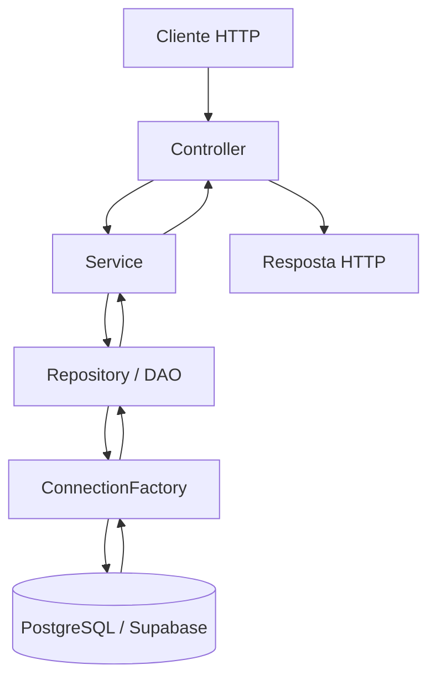
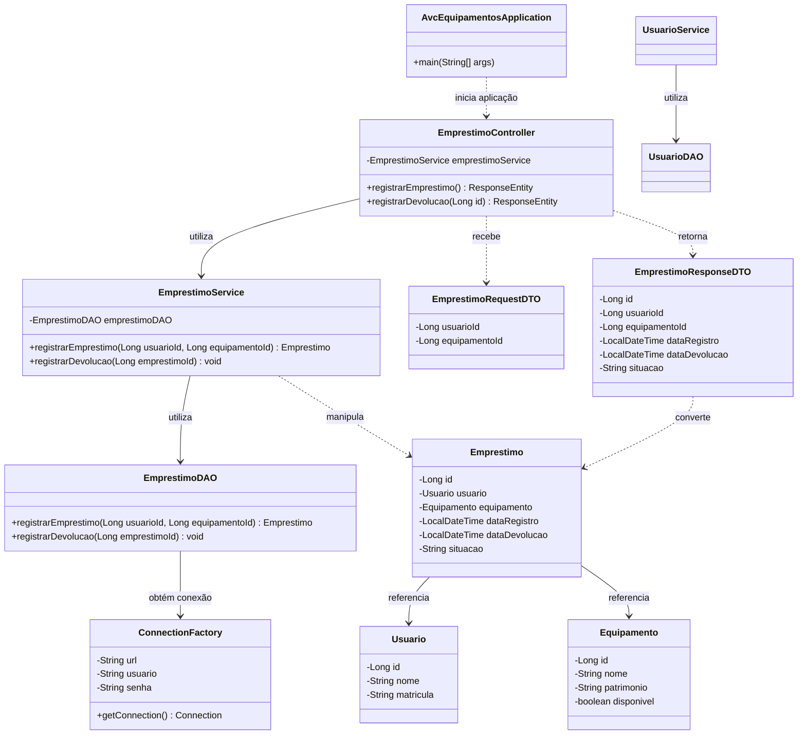

# Sistema de Empréstimo de Equipamentos

Projeto acadêmico desenvolvido para a disciplina de Engenharia de Software da UNISA. O sistema tem como objetivo gerenciar empréstimos e devoluções de equipamentos, relacionando usuários, equipamentos e registros de empréstimo.

## 1. Tecnologias utilizadas

- **Java** — linguagem de programação.
- **Spring Boot** — estrutura da aplicação e exposição dos endpoints REST.
- **JDBC** — comunicação com o banco de dados por meio de comandos SQL.
- **PostgreSQL** — banco de dados relacional.
- **Supabase** — serviço utilizado para disponibilização do PostgreSQL.
- **Maven** — gerenciamento de dependências e execução dos testes.

## 2. Arquitetura do sistema

A aplicação utiliza uma arquitetura em camadas, separando as responsabilidades do código.

| Camada | Responsabilidade |
|---|---|
| `controller` | Receber requisições HTTP e retornar respostas da API. |
| `service` | Aplicar validações e regras de negócio. |
| `repository` / `DAO` | Executar consultas e operações SQL no banco de dados. |
| `model` | Representar as entidades do domínio. |
| `dto` | Transportar os dados de entrada e saída da API. |
| `config` | Centralizar configurações de infraestrutura, incluindo a conexão com o banco. |

### Fluxo de uma requisição

Uma requisição HTTP chega ao controller, que utiliza o service para executar a operação. O service acessa a camada de persistência, responsável pelas operações no banco de dados. O resultado retorna pelas camadas até formar a resposta HTTP.



## 3. Diagrama de classes UML

O diagrama abaixo representa as principais classes identificadas na implementação documentada do sistema.



## 4. Persistência e transações

A classe `ConnectionFactory` centraliza a criação de conexões JDBC. A classe `EmprestimoDAO` executa as operações de empréstimo e devolução utilizando comandos SQL.

As operações de empréstimo e devolução utilizam transações manuais, com `commit` para confirmar as alterações e `rollback` em caso de falha. O empréstimo também utiliza bloqueio de registro durante a verificação da disponibilidade do equipamento, reduzindo o risco de empréstimos simultâneos do mesmo item.

## 5. Endpoints de empréstimos

| Método | Endpoint | Finalidade |
|---|---|---|
| `POST` | `/emprestimos` | Registrar um empréstimo. |
| `PATCH` | `/emprestimos/{id}/devolucao` | Registrar a devolução de um empréstimo. |

### Exemplo de requisição para empréstimo

```json
{
  "usuarioId": 1,
  "equipamentoId": 1
}
```

O endpoint de criação retorna o status HTTP `201 Created` quando a operação é concluída. O endpoint de devolução retorna `204 No Content` em caso de sucesso.

## 6. Configuração do banco de dados

A aplicação utiliza variáveis de ambiente para configurar a conexão com o PostgreSQL:

- `DB_URL` — URL JDBC do banco.
- `DB_USER` — usuário do banco.
- `DB_PASSWORD` — senha do banco.

Essas variáveis devem ser configuradas no ambiente de execução. Credenciais reais não devem ser adicionadas ao repositório.

## 7. Testes

Os testes automatizados estão localizados em `src/test/java`. Para executar a suíte de testes, utilize o Maven na pasta que contém o arquivo `pom.xml`:

```bash
mvn test
```

O resultado da execução deve ser verificado no terminal. A compilação bem-sucedida, isoladamente, não comprova que todos os fluxos da API funcionam corretamente.

## 8. Organização do projeto

```text
src/
├── main/
│   ├── java/br/com/unisa/avc_equipamentos/
│   │   ├── algoritmos/
│   │   ├── config/
│   │   ├── controller/
│   │   ├── dto/
│   │   ├── model/
│   │   ├── repository/
│   │   ├── service/
│   │   └── AvcEquipamentosApplication.java
│   └── resources/
│       └── application.properties
└── test/
    └── java/br/com/unisa/avc_equipamentos/
```

**Observação:** a documentação deverá ser atualizada conforme as demais funcionalidades do projeto forem integradas pela equipe.

## 9. Módulo de Algoritmos

O módulo de algoritmos está localizado em `src/main/java/br/com/unisa/avc_equipamentos/algoritmos/ModuloAlgoritmos.java`.

A implementação original foi desenvolvida por Fernando Oliveira. Durante a revisão técnica, foram realizados ajustes para adequar os critérios de busca e ordenação ao requisito de identificação dos equipamentos por ID.

O módulo trabalha com uma coleção de equipamentos armazenada em memória, recebida por meio do construtor da classe. A coleção é copiada para uma lista interna, sem realizar consultas SQL diretamente ou expor endpoints REST.

### Busca linear — T-17

O método `buscaLinear(Long id)` percorre sequencialmente a coleção até encontrar um equipamento com o ID informado.

- Complexidade de tempo: O(n) no pior caso.
- Melhor caso: O(1), quando o equipamento está na primeira posição.
- Complexidade de espaço adicional: O(1).

### Busca binária — T-18

O método `buscaBinaria(Long id)` utiliza a busca binária para localizar um equipamento pelo ID. Antes da pesquisa, a coleção é ordenada em ordem crescente de ID utilizando o Insertion Sort.

- Complexidade da busca: O(log n).
- Complexidade da ordenação prévia: O(n²) no pior caso.
- Complexidade total da chamada: O(n²) no pior caso, considerando a ordenação prévia.
- Complexidade de espaço adicional: O(1).

A ordenação prévia é necessária porque a busca binária depende de uma coleção ordenada pelo mesmo critério utilizado na comparação.

### Insertion Sort — T-19

O método `insertionSort()` ordena os equipamentos em ordem crescente de ID, inserindo cada elemento na posição correta em relação aos elementos anteriores.

- Melhor caso: O(n), quando a coleção já está ordenada.
- Pior caso: O(n²), quando são necessários muitos deslocamentos.
- Complexidade de espaço adicional: O(1).

### Observações

Os algoritmos utilizam o atributo `id` da classe `Equipamento`, do tipo `Long`, como critério de comparação.

O construtor recebe uma lista não nula e valida se todos os equipamentos possuem identificadores válidos. A busca retorna `null` quando o ID informado não é encontrado ou é nulo.

A ordenação modifica a lista interna do módulo, enquanto o método `getEquipamentos()` retorna uma cópia da coleção.

A compilação e a demonstração do módulo foram executadas com sucesso. Os testes JUnit específicos dos algoritmos permanecem pendentes de execução e validação.

### Demonstração reproduzível

A classe `DemonstracaoAlgoritmos` cria uma coleção fixa de cinco equipamentos em memória, com IDs inicialmente fora de ordem.

Os dados são gerados localmente no código, sem consulta ao PostgreSQL/Supabase e sem requisições HTTP ou utilização do Postman.

Para executar a demonstração, na pasta `avc-equipamentos`, execute:

```bash
mvn -DskipTests compile
java -cp target/classes br.com.unisa.avc_equipamentos.algoritmos.DemonstracaoAlgoritmos
```

**Saída esperada:**

```text
Busca linear pelo ID 3:
Notebook

Busca binária pelo ID 4:
Projetor

Equipamentos ordenados por ID:
1 - Monitor
2 - Mouse
3 - Notebook
4 - Projetor
5 - Teclado
```
